# hey, I’m Tony 👋

I’m binaryYuki on GitHub. I study computer science at King’s College London, write Go, Python and Java, and run a blog at [catyuki.com](https://www.catyuki.com).

A recent evening on my k3s cluster went something like this. My browser asked for `dashboard.js` and got a `401`. I asked the pod for the same file and got a `200`. The browser had sent the cookie. By this point I had several terminals open and a much more specific question than “why is the dashboard broken?”

Anyway, if you ever want to compare CDN behaviour, feel free to send me a `curl` command. I’ll probably run it.

### What I’ve been up to

🎵 **Rhythm Realm** is a music practice app I work on. One detail I like is how singing practice works. Your device figures out the pitch while you sing, so your recording stays with you. Lately I’ve been working on the AI side. Getting a model to write a new exercise is one thing. Getting it to write one the app can actually play has been the interesting bit.

🐈 **[catyuki.com](https://www.catyuki.com)** is my blog. Running it also gives me somewhere to try things out. Recently I’ve been comparing CDN routes and checking which files actually arrive Brotli-compressed. Yes, that included a PDF.

🛠️ **TestClaw** is my final-year project at King’s. I’m working with TG0 on it this year, so there’s some hardware mixed in with all the backend work for a change.

### Around the web

You can reach me at [hello@catyuki.com](mailto:hello@catyuki.com) or find me on [LinkedIn](https://www.linkedin.com/in/tingzhanghuang/). I graduate in 2027 and I’m open to backend, platform or AI infra roles in the UK or Malta. [Here’s my CV](https://oss.catyuki.com/cv.pdf).

  
For the graphs 👀

  <picture>
    <source media="(prefers-color-scheme: dark)" srcset="https://github-stats-extended.vercel.app/api?username=binaryyuki&theme=radical" />
    
  </picture>
  

  

